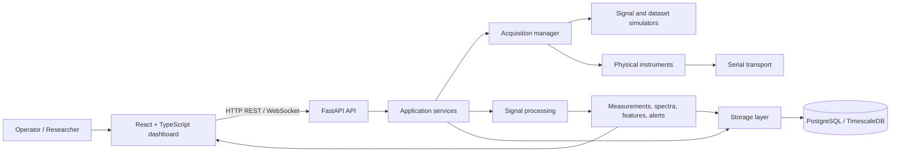
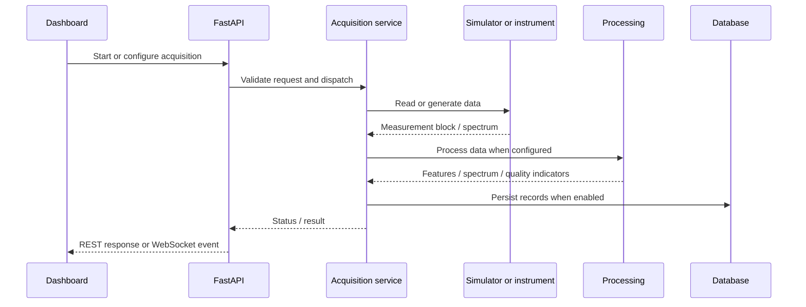

# InstrumentHub — Architecture

## Purpose

InstrumentHub is a platform for acquiring, processing, storing and analysing data from biomedical instruments and sensors. It supports simulated sources and integrations with physical instruments, including an IBSEN I-MON optical interrogator workflow for fibre Bragg grating (FBG) analysis.

> **Evidence policy:** this document describes the intended/current project architecture from the repository overview. Verify implementation details against the checked-out code before treating every component as production-ready. Simulated data must never be presented as measurements from physical hardware.

## System context



## Main layers

| Layer | Responsibility |
|---|---|
| Frontend | React/TypeScript dashboard, forms, time-series and spectrum visualisation, analysis views. |
| API | FastAPI routes, request validation, REST endpoints and WebSocket connections. |
| Services | Orchestrate acquisition, processing, device management, experiments, alerts and persistence. |
| Acquisition | Simulated sources, dataset playback and hardware transports/drivers. |
| Processing | Statistics, digital filters, FFT/PSD, anomaly checks and FBG-specific calculations. |
| Storage | SQLAlchemy models and persistence for devices, channels, measurements, spectra, experiments, calibrations, processing jobs and alerts. |
| Infrastructure | Docker/Compose, CI, configuration and developer tooling. |

## Typical measurement flow



## Realtime transport

- REST is used for configuration and request/response operations.
- WebSockets are used for streaming updates where the relevant endpoint is implemented.
- Reverse proxies must preserve the `/api/` path and support WebSocket upgrade headers.
- A WebSocket message schema should be treated as a versioned API contract. Confirm message `type` and payload fields against the backend and frontend types.

## Deployment boundaries

- Local development may run API and frontend directly, or through Docker Compose.
- A serial instrument is physically connected to the host. A Linux container does not automatically gain access to a Windows `COM` port; device passthrough must be configured and tested explicitly.
- Database persistence is separate from the acquisition source.
- Cloud integration is optional and should export only explicitly approved data. Keep hardware acquisition local unless a tested networking and safety design says otherwise.

## Design principles

1. Keep transport/driver logic separate from API route handlers.
2. Validate units, timestamps, channel identifiers and quality flags at system boundaries.
3. Keep raw data distinct from derived features and calibrated values.
4. Record the source of every dataset: `synthetic`, `replay`, or `physical`.
5. Do not claim throughput or accuracy without a reproducible benchmark and saved output.
6. Store credentials in environment configuration or a secret manager, never in source control.

## Suggested repository map

Names may differ slightly in the current checkout; use the actual repository as the source of truth.

```text
app/
  api/            # REST and WebSocket endpoints
  acquisition/    # acquisition orchestration and protocols
  devices/        # device abstractions and instrument drivers
  processing/     # filters, statistics, spectral and FBG processing
  services/       # application services
  storage/        # persistence and repositories
  models/         # domain/database models
frontend/         # React + TypeScript UI
scripts/          # benchmark and demo data utilities
tests/            # unit and integration tests
docs/             # stage and operator documentation
```
