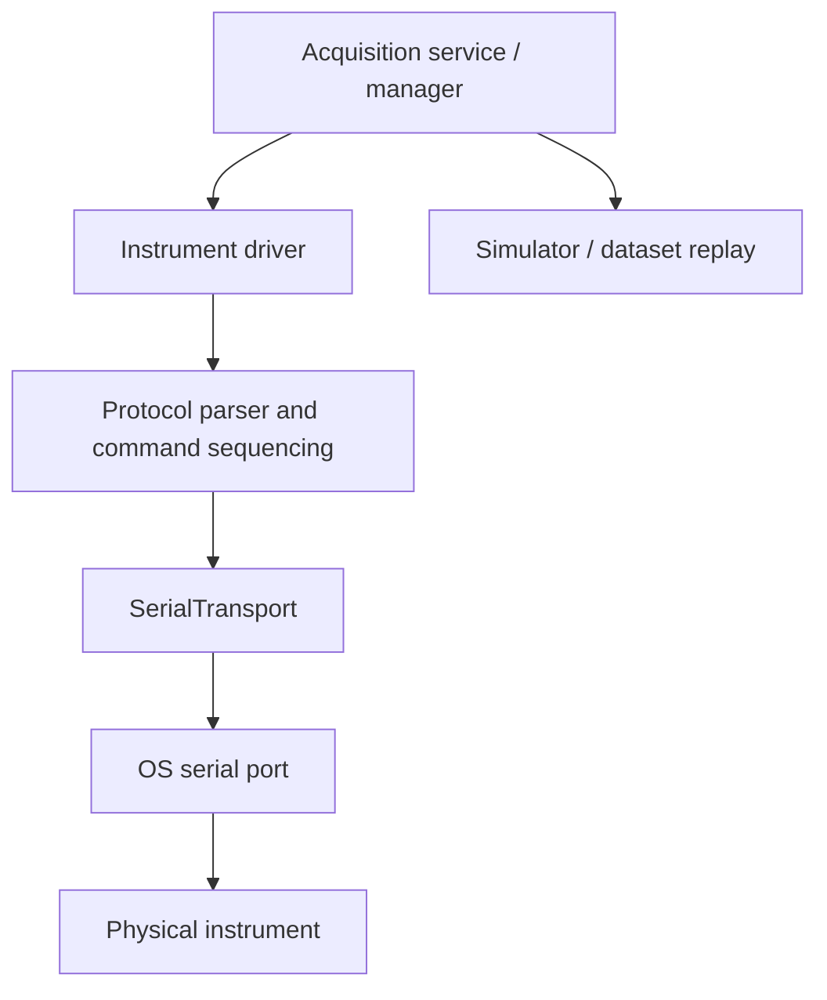
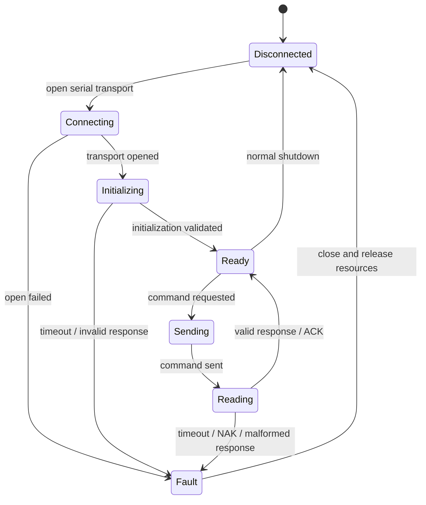

# InstrumentHub — Device Protocols

## Scope

This document describes the device integration model and operational requirements. Exact IBSEN I-MON command bytes, terminators, ACK/NAK values, framing, timeouts and response layouts must be taken from the driver and the manufacturer's protocol documentation. This file deliberately does **not** invent undocumented command values.

## Device integration layers



The acquisition manager should depend on a stable instrument interface rather than on device-specific serial commands. This allows a simulator to exercise most application workflows without claiming to reproduce all hardware behaviour.

## Serial transport checklist

Before connecting a physical instrument:

1. Confirm the exact device model, firmware and supported interface.
2. Confirm the host port name (`COM3` on Windows, or a path such as `/dev/ttyUSB0` on Linux).
3. Obtain the correct baud rate, data bits, parity, stop bits, flow-control and timeout from the instrument manual.
4. Ensure no other application owns the serial port.
5. Start with a conservative read timeout and explicit error handling.
6. Log connection state and protocol errors without logging secrets or unbounded binary payloads.
7. Close the transport reliably on cancellation, exceptions and application shutdown.

Example configuration (illustrative only):

```python
# Replace these values with the values specified for the actual instrument.
port = "COM3"
baudrate = 115200
timeout_seconds = 1.0
```

Do not assume `115200` is correct for the connected IBSEN device; use the instrument's documented configuration.

## Request/response state machine



The diagram is a generic control-flow model. Match the actual states and response semantics to `app/devices/instruments/ibsen.py`, `app/acquisition/protocols/ibsen.py` and the vendor protocol manual.

## ACK, NAK and framing

- Treat ACK as successful acknowledgement only when the device protocol defines it that way.
- Treat NAK as a rejected command or protocol error according to the vendor specification.
- Distinguish timeout, framing error, checksum/validation failure and device rejection.
- Do not blindly retry non-idempotent commands. Bound retries and record the reason.
- Validate response length and field formats before parsing numeric values.
- Use explicit encoding and terminator rules from the protocol specification.

## IBSEN I-MON spectrum workflow

The project includes an IBSEN-oriented serial driver and a calibration model that maps pixel indices to wavelength using polynomial coefficients. The exact initialization and read sequence must be verified in the checked-out implementation and against the connected instrument.

A spectrum-processing pipeline should preserve:
- raw pixel indices;
- raw intensity values;
- device identifier and acquisition timestamp;
- the calibration coefficients and calibration version used;
- derived wavelength values;
- instrument connection/read errors and quality indicators.

## Pixel-to-wavelength calibration

A polynomial calibration can be represented as:

\[
\lambda(p) = a_0 + a_1 p + a_2 p^2 + a_3 p^3 + a_4 p^4 + a_5 p^5
\]

where `p` is the pixel index and coefficients `a0 ... a5` must come from a real calibration procedure or trusted calibration file. Units (for example, nm) must be explicit.

Do not use placeholder coefficients for scientific reporting. Store the coefficient set, units, calibration date/source and applicable pixel range with the result.

## Hardware validation record

For every physical test, record:

| Field | Value to record |
|---|---|
| Device model / serial | Actual device identity |
| Firmware | Actual firmware version |
| Host OS and port | Actual test environment |
| Serial settings | Verified settings |
| Driver revision | Git commit or release |
| Calibration | Coefficients, units, provenance |
| Test date | Timestamp and timezone |
| Outcome | Pass/fail and observed errors |
| Data artifact | Path to saved raw data and logs |

A simulator test validates application logic, not physical serial communication, optical accuracy or hardware sampling performance.
