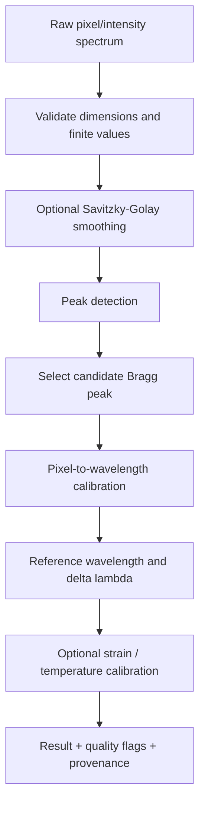

# InstrumentHub — Fibre Bragg Grating (FBG) Analysis

## Scope

The FBG workflow analyses optical spectra to estimate a Bragg wavelength and, when valid calibration coefficients are available, derive a wavelength shift and estimate strain or temperature. Numerical outputs are only as reliable as the input spectrum, peak selection, optical calibration and sensor-specific coefficients.

## Pipeline

## Spectrum input

Preserve the original pixel/intensity arrays. Check that:
- both arrays have compatible lengths;
- values are finite;
- intensity is within the expected detector range;
- the spectrum is not empty, truncated or saturated;
- the wavelength calibration applies to the actual instrument and pixel range.

Smoothing is optional. A filter may suppress noise but can also alter narrow peaks or move a peak location. Keep the raw and processed spectra available for comparison.

## Peak detection

The project uses a Savitzky-Golay smoothing approach and peak detection. Peak prominence, minimum distance, width and smoothing-window length affect which peaks are returned. Parameters must be chosen based on the spectrum and validated with representative samples.

Do not assume the highest intensity peak is always the correct Bragg peak. Multiple gratings, reflections, side lobes and artefacts may be present. A robust result should retain peak-selection metadata and report an ambiguity/quality flag when selection is uncertain.

## Bragg wavelength and wavelength shift

For a selected peak, the Bragg wavelength is the wavelength associated with that peak after applying a validated pixel-to-wavelength calibration.

\[
\Delta \lambda_B = \lambda_{B,\mathrm{measured}} - \lambda_{B,\mathrm{reference}}
\]

The reference wavelength must be defined for the sensor under documented baseline conditions. State wavelength units explicitly (commonly nm).

## Strain and temperature calibration

For small changes, a sensor-specific linear approximation may be used:

\[
\Delta \lambda_B = K_\varepsilon \varepsilon + K_T \Delta T
\]

where `Kε` and `KT` are sensor-dependent sensitivities. A single wavelength shift generally cannot uniquely determine both strain and temperature without additional information or compensation.

Do not reuse placeholder coefficients or assume a universal sensitivity. Coefficients must be measured, supplied by the sensor manufacturer or taken from a traceable calibration record. Document the units and whether strain is represented as dimensionless strain or microstrain.

## Calibration provenance

For every analysis result, record where possible:
- instrument and sensor identifiers;
- raw spectrum reference;
- pixel-to-wavelength polynomial coefficients and version;
- reference Bragg wavelength;
- strain/temperature sensitivity coefficients and units;
- processing parameters (smoothing window/order, peak criteria);
- software version and analysis timestamp;
- quality flags and peak-selection rationale.

## Validation strategy

Use synthetic spectra with known peaks to test the algorithm's mechanics. Then validate against saved reference spectra and, finally, physical measurements with known instrument and sensor conditions.

Recommended tests:
1. single clean peak at a known wavelength;
2. noisy peak with controlled noise;
3. multiple peaks and side lobes;
4. flat or empty spectrum;
5. clipped/saturated peak;
6. invalid calibration or out-of-range pixel;
7. missing/non-finite values;
8. known wavelength shift;
9. calibrated strain/temperature examples with traceable coefficients.

Synthetic tests verify numerical behaviour; they do not establish optical measurement accuracy.
