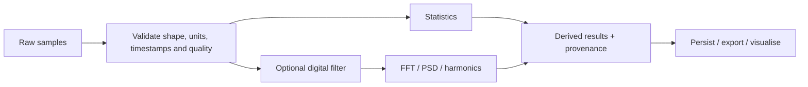

# InstrumentHub — Signal Processing

## Purpose and data provenance

InstrumentHub's processing layer includes statistical summaries, digital filtering and spectral analysis. The project also includes anomaly-related processing and FBG-specific analysis.

Always identify the origin of the input:
- **synthetic** — generated mathematically for development or repeatable tests;
- **replay** — loaded from a saved dataset;
- **physical** — acquired from a connected instrument.

Never report synthetic processing throughput as physical instrument acquisition throughput.

## Processing flow

## Statistics

Useful summary measures include sample count, minimum, maximum, mean, standard deviation and root-mean-square where implemented. Interpret the values in the context of:
- physical units;
- sample rate and window duration;
- missing or invalid samples;
- sensor range and calibration;
- whether standard deviation is population or sample standard deviation.

Do not infer clinical significance from descriptive statistics alone.

## Digital filters

The project includes a Butterworth filter implementation. A Butterworth response is maximally flat in the passband; practical use still requires correct filter design parameters.

Before filtering, validate:
- sampling frequency is positive;
- cutoff frequency is valid for the selected filter and below the Nyquist frequency (`fs / 2`);
- input data are finite and sufficiently long for the filter implementation;
- filter order and edge handling are appropriate for the signal.

Filtering can introduce phase delay (depending on the method), edge transients and amplitude changes. Document whether the implementation is causal or uses forward-backward filtering. Do not assume zero-phase behaviour unless the code uses an appropriate method such as forward-backward filtering.

## FFT and spectral interpretation

For a uniformly sampled signal with sampling frequency `fs` and `N` samples, the nominal frequency-bin spacing is:

\[
\Delta f = \frac{f_s}{N}
\]

The Nyquist frequency is:

\[
f_N = \frac{f_s}{2}
\]

FFT results depend on the sampling interval, detrending, windowing, scaling and one-sided/two-sided convention. A peak in a spectrum is not automatically a valid physical frequency: inspect aliasing, leakage, harmonics, noise and sensor response.

PSD units depend on the implementation and input units. Confirm the function's normalisation before comparing amplitudes across datasets.

## Sampling rates and benchmark interpretation

The reproducible benchmark plan targets synthetic processing blocks at 100 Hz, 500 Hz, 1 kHz and 5 kHz. These rates are **test configurations**, not proof that a physical instrument can acquire at those rates.

For a block of `N` samples at `fs`, its nominal duration is `N / fs`. A block-processing p95 latency below that duration suggests the tested processing operation met that block budget on the tested machine; it does not establish end-to-end real-time performance of the full application.

Record:
- machine and OS;
- Python and dependency versions;
- git commit;
- benchmark arguments and random seed;
- p50, p95 and p99 latency;
- processed samples per second;
- CPU and memory measurements;
- whether timing includes data generation, I/O, persistence or plotting.

## Anomaly detection and quality

An anomaly flag is a screening signal, not a diagnosis. A threshold should be associated with a signal, unit, expected range, duration/persistence rule and severity. Evaluate false positives and false negatives using labelled data when possible.

Keep signal quality indicators distinct from physical alarm conditions. A communication timeout, missing sample or saturated sensor may invalidate downstream analysis even when numeric values look plausible.

## Reproducibility

Store raw input or a stable dataset reference alongside processing parameters and outputs. Include filter order/cutoff, FFT window, sample rate, calibration version and software version in metadata where applicable. Tests should cover empty arrays, short arrays, NaNs/infinities, invalid rates and known reference signals.
