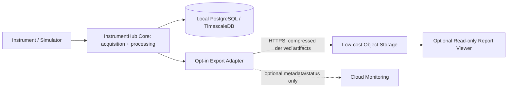

# Low-Cost Cloud Integration — Design Only

## Status

This document prepares a cloud integration boundary; it does **not** deploy services, create accounts/resources, or claim a live cloud connection. AWS deployment remains a separate stage as requested.

## Recommended boundary

Keep acquisition, instrument drivers, low-latency processing and the primary database close to the hardware. Add an explicit export/synchronization adapter that uploads only approved experiment metadata, derived results and selected reports. Do not stream raw sensor samples or spectra to the cloud by default.

## Initial synchronization contract

Each export should carry:

- `schema_version` and `export_id` for forward compatibility and idempotency.
- Experiment/device identifiers that are pseudonymous where possible.
- Creation timestamp in UTC, software version and source type (`synthetic` or `physical`).
- Units, calibration provenance and processing parameters for derived values.
- Content checksum and a manifest of included files.
- Explicit consent/allow-list for any data leaving the local environment.

Use retries with bounded exponential backoff and an outbox/queue so a temporary network outage never blocks acquisition. Do not make the cloud endpoint a hard dependency for local acquisition.

## Cost and security controls

- Start with periodic uploads of small, compressed reports rather than always-on telemetry.
- Set a monthly budget/alert and object lifecycle/retention policy before enabling uploads.
- Avoid managed database replication until there is a demonstrated need; duplicate raw data can dominate storage and egress cost.
- Use TLS, short-lived workload identity where supported, least privilege and managed secrets.
- Encrypt sensitive exports, minimize personal/device identifiers and define deletion/retention rules.
- Keep local logs and measurements usable when the cloud is unavailable.

## Acceptance criteria for the later cloud stage

- [ ] A provider and explicit monthly budget are approved.
- [ ] Export schema and idempotency behavior are tested locally.
- [ ] Credentials use short-lived identity; no long-lived access keys in source control.
- [ ] Failure/retry behavior is tested with network disabled.
- [ ] Data retention, deletion, encryption and access policy are documented.
- [ ] Actual recurring cost is verified from provider billing/usage tools after a controlled pilot.

No provider-specific service is selected here. The architecture can later be implemented with an object store and small serverless/API component, but that decision belongs to the separate cloud stage.
